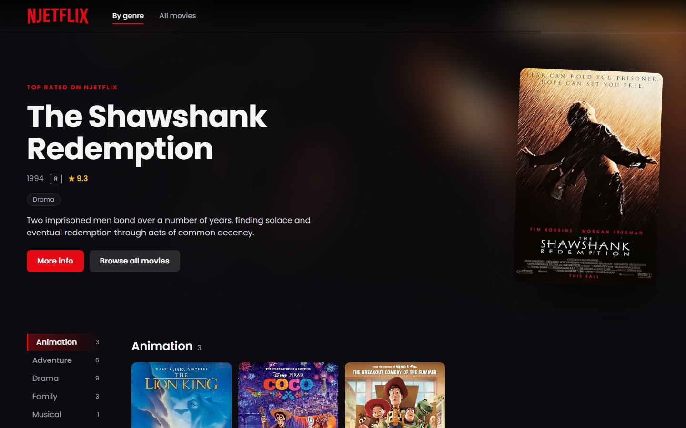
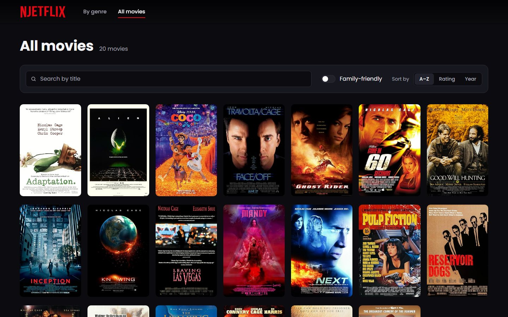
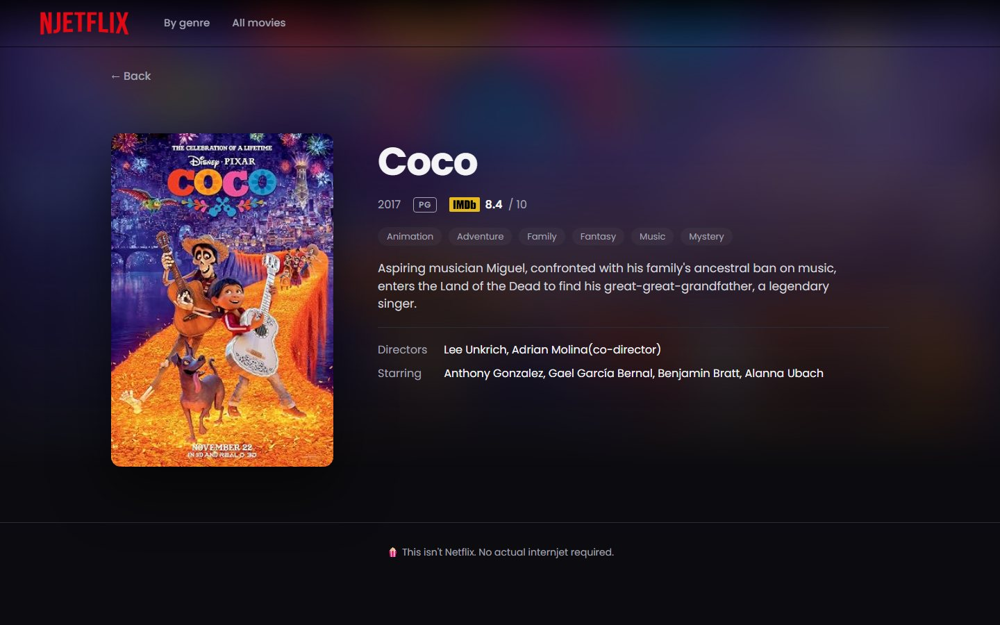
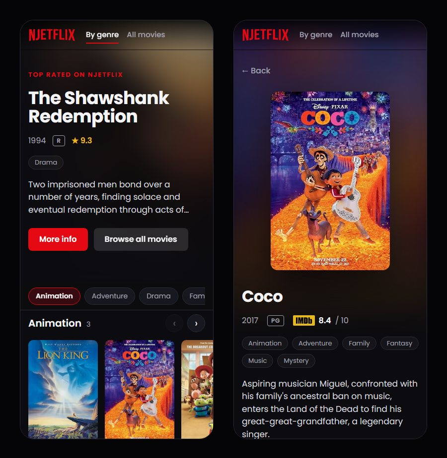

# <p align="center">(🍿 This isn't Netflix)  </p>

A movie browser with a genre view, a searchable and sortable list of every movie, and a page for each movie. It runs on a small Express API that serves mock movie data.



| All movies | Movie page | Mobile |
| --- | --- | --- |
|  |  |  |

## 🚀 Quick start

You need [Node.js](https://nodejs.org/) 22.22 or newer (see `.nvmrc`).

1. **Clone this repository**

   ```shell
   git clone https://github.com/atmasark/njetflix
   cd njetflix
   ```

2. **Install dependencies**

   Fancy one-command now available. It installs both the API and the client.

   ```shell
   npm install
   ```

3. **Start up**

   ```shell
   npm run dev
   ```

4. **Enjoy the Njetflix**

   Your site is now running at `http://localhost:8080`!
   No actual internjet required.

## 🧰 Scripts

Run these from the repository root.

| Command             | What it does                                                        |
| ------------------- | ------------------------------------------------------------------- |
| `npm run dev`       | Starts the API (port 2500) and the client (port 8080) with hot reload |
| `npm run build`     | Builds the client and the API for production                        |
| `npm start`         | Serves the built app and the API together on port 2500 (`PORT` to change) |
| `npm test`          | Runs the API and client tests                                       |
| `npm run lint`      | Lints everything with ESLint                                        |
| `npm run typecheck` | Type-checks both workspaces                                         |

## 🗂️ Project structure

```
api/      Express 5 API serving the movie data from mockdata.json
client/   React 19 app built with Vite
```

The client calls the API through `/api`. In development, Vite proxies those requests to port 2500. In production, the API serves the built client itself, so everything runs on one origin.

### API

| Route                 | Response                                       |
| --------------------- | ---------------------------------------------- |
| `GET /api/movies`     | `{ list }`: every movie with summary fields    |
| `GET /api/movies/:id` | `{ current }`: one movie with all its details  |

The v1 routes `/api/movie/getAll` and `/api/movie/getSingle?id=` still work.

## 🛠️ Built with

React 19, React Router, Redux Toolkit, styled-components, Vite, Express 5, TypeScript, Vitest and ESLint.
